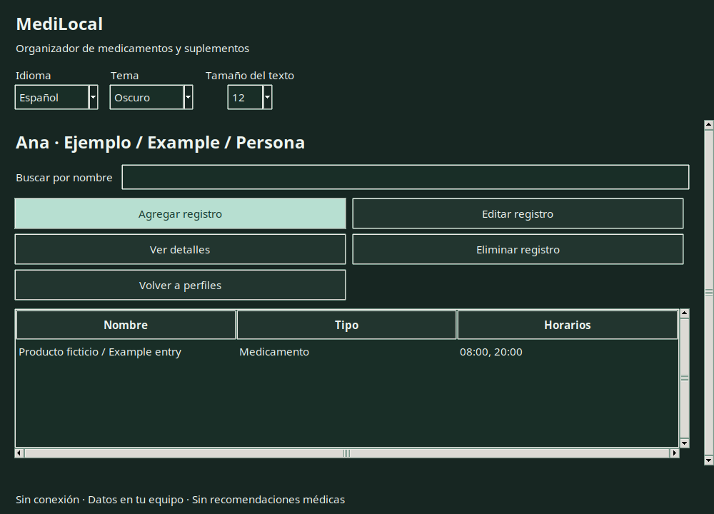
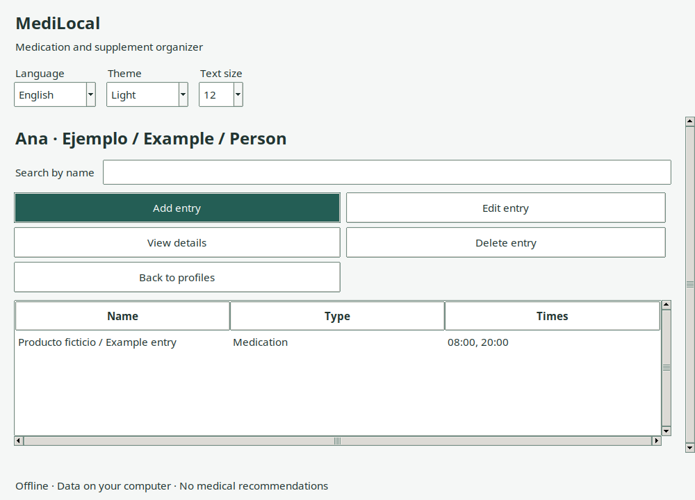

# MediLocal

Organizador de medicamentos y suplementos para personas y mascotas, hecho en
**Python + Tkinter + SQLite**. Funciona sin conexión, cuentas, anuncios ni telemetría.

**Español / English · Tema oscuro / claro · Tamaño de texto ajustable**

## Descargar y abrir

[Versiones y descargas de MediLocal](https://github.com/MartnMartnez14/medilocal/releases)

La versión gráfica 2.0 es preliminar. Si todavía no hay un paquete publicado,
consultá las ejecuciones de [GitHub Actions](https://github.com/MartnMartnez14/medilocal/actions)
o usá el código fuente como se indica más abajo. No hay versión móvil ni web.

- **Windows x64:** descargá el ZIP correspondiente, extraé **toda** la carpeta y
  abrí `MediLocal.exe`.
- **Linux x64:** extraé toda la carpeta y abrí `MediLocal`. Si el escritorio lo
  requiere, habilitá «Permitir ejecutar como programa» en las propiedades del archivo.
- Conservá la carpeta `_internal` junto al ejecutable. Los paquetes incluyen Python;
  para usarlos no necesitás instalar Python ni abrir una terminal.
- Los paquetes no tienen firma digital. No se afirma compatibilidad con todos los
  escritorios Linux; el entorno de construcción es Ubuntu 22.04 x64.

## Mini tutorial sin conocimientos técnicos

1. Abrí MediLocal. Arriba podés elegir **Idioma**, **Tema** y **Tamaño del texto**.
   La aplicación recuerda estas elecciones al volver a abrirla.
2. Pulsá **Crear perfil**, escribí un nombre o apodo y elegí Persona o Mascota.
3. Seleccioná el perfil y pulsá **Abrir perfil**.
4. Pulsá **Agregar registro**. Elegí medicamento o suplemento y copiá la cantidad
   indicada por el profesional. MediLocal no calcula ni recomienda dosis.
5. Escribí las horas en formato de 24 horas, separadas por coma: `08:00, 20:00`.
   Las horas repetidas se guardan una sola vez. Pulsá **Guardar**.
6. Seleccioná un registro para **Ver detalles**, **Editar** o **Eliminar**.
7. Volvé a perfiles y abrí **Copias de seguridad → Exportar copia**. Guardá el archivo
   en un lugar privado. Para recuperar una copia, elegí **Restaurar copia**: reemplaza
   todos los perfiles, previa confirmación y respaldo automático del estado anterior.

No hay avisos automáticos ni registro de tomas realizadas. Los horarios son diarios;
no representan pautas semanales, tratamientos por intervalos ni indicaciones clínicas.

## Interfaz real

Capturas de Linux con datos ficticios, generadas desde la aplicación de escritorio:

### Español · Oscuro



### English · Light



También disponibles: [Español claro](docs/images/es-light.png) y
[English dark](docs/images/en-dark.png).

## Privacidad y archivos

- **Linux:** `$XDG_DATA_HOME/medilocal` o `~/.local/share/medilocal`.
- **Windows:** `%LOCALAPPDATA%\MediLocal`.
- La pantalla de copias muestra la carpeta exacta. La base se llama `medilocal.db`;
  las preferencias se guardan aparte en `settings.json`.
- La base y las copias **no están cifradas**. No hay contraseña dentro de MediLocal.
  Los perfiles no son cuentas separadas: cualquiera que use tu sesión del equipo
  puede consultar todos ellos. Usá la protección del sistema operativo.
- Reemplazar la carpeta del programa al actualizar no elimina los datos.
  Desinstalar/borrar el programa tampoco borra la carpeta de datos.
- Los respaldos previos a restaurar se llaman `before-restore-<fecha>.db` en la
  carpeta de datos. Administralos manualmente; no se eliminan automáticamente.
- No uses la base activa en carpetas de red o sincronizadas. Cerrá otros programas
  que accedan a ella. Solo se permite una instancia de MediLocal por carpeta.

### Importar la versión antigua

MediLocal ofrece importar `data/medilocal.db` si lo encuentra junto al código o
al ejecutable y no hay perfiles nuevos. También podés elegirlo manualmente desde
**Copias de seguridad → Importar base antigua**. La importación requiere una base
nueva vacía; no mezcla registros ni cambia el archivo original.

Un horario antiguo que no sea `HH:MM` se conserva literalmente y queda marcado
**Revisar horario original**. Abrí el registro y escribí las horas correctas para
continuar. Nunca se inventan horas ni se convierten pautas automáticamente.
Si rechazás o cancelás la importación, el archivo original queda intacto.

## Ejecutar desde el código fuente

Requiere Python **3.12 o posterior**, SQLite y Tkinter/Tk 8.6. No requiere instalar
paquetes pip para el funcionamiento normal. Algunas distribuciones separan Tkinter
como un componente del sistema; no se instala automáticamente.

```bash
git clone https://github.com/MartnMartnez14/medilocal.git
cd medilocal
python3 app.py
```

En Windows, usá `python app.py` o el lanzador `py app.py`.

Alternativa de terminal, con la misma base y validaciones:

```bash
python3 app.py --cli
python3 app.py --cli --lang en
```

`--lang es` y `--lang en` permiten elegir el idioma para esa sesión; la selección
hecha desde el control superior de la aplicación se guarda para próximas aperturas.

## Pruebas y desarrollo

```bash
python3 -m unittest discover -v
# Con una pantalla disponible, pruebas reales de ventanas:
MEDILOCAL_GUI_TESTS=1 python3 -m unittest tests.test_gui -v
```

[Validación y límites de evidencia](docs/VALIDACION.md) ·
[Contribuir](CONTRIBUTING.md) · [Seguridad](SECURITY.md) ·
[Componentes y licencias](THIRD_PARTY_NOTICES.md)

La arquitectura separa interfaz, traducciones, validación y persistencia. El flujo
`.github/workflows/desktop.yml` prueba y construye Linux/Windows por separado.
Los tags `v2.*` publican una **prerelease** solo si pasan ambos trabajos. La publicación
estable requiere validación manual adicional; el flujo no la declara estable.

## Próximas etapas

- Validación manual en Windows y con lectores de pantalla por plataforma.
- Mejoras de navegación y accesibilidad a partir de pruebas con usuarios.
- Evaluar recordatorios e historial de tomas en otro alcance, sin asumir prestaciones.
- Evaluar cifrado y cualquier sincronización antes de cambiar el modelo de privacidad.

## English

MediLocal is an offline desktop medication and supplement organizer for people
and pets. It offers **English/Spanish, light/dark themes and adjustable text**, with
preferences saved on the computer. It does not calculate doses, recommend treatment,
send health data, synchronize devices or provide automatic reminders.

Download a platform ZIP from [Releases](https://github.com/MartnMartnez14/medilocal/releases),
extract the entire folder and open `MediLocal.exe` (Windows) or `MediLocal` (Linux).
Keep `_internal` alongside the executable. Packages include Python and are unsigned.

Choose **English** at the top. Create a profile, open it, add an entry, enter the
prescribed amount and comma-separated 24-hour times such as `08:00, 20:00`, then
save. Use **View details** for notes and full information. Export a backup from
**Backups**. Restoring replaces all profiles after validation and a safety backup.
Old CLI databases can be imported into an empty database; invalid old times are
preserved for manual review, and the original database remains unchanged.

Data lives in `%LOCALAPPDATA%\MediLocal` on Windows and
`$XDG_DATA_HOME/medilocal` (default `~/.local/share/medilocal`) on Linux.
**Databases and backups are not encrypted.** Profiles do not isolate users within
an OS account. Keep your session and backups private. No network/shared active
SQLite databases are supported. See the validation document for tested behavior
and platform/accessibility limitations.

## Licencia / License

[MIT](LICENSE). Componentes de terceros conservan sus propias licencias.
